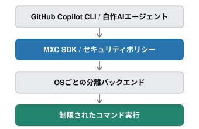
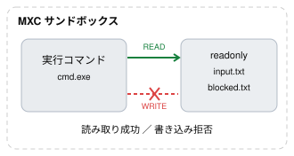

# Microsoft eXecution Container（MXC）を試す — Windows 11での導入からGitHub Copilot CLIのローカルサンドボックスまで

生成AIを利用したソフトウェア開発では、AIエージェントがファイルの編集、プログラムの実行、ネットワークアクセスなどを自律的に行うようになってきました。

便利になる一方で、意図しないファイルの変更や削除、機密情報へのアクセス、不適切なコマンドの実行といったリスクもあります。

こうした問題への対策の一つが、**サンドボックスによる実行環境の隔離**です。

今回はMicrosoftが公開しているオープンソースの **Microsoft eXecution Container（MXC）** をWindows 11上で動かし、ファイルシステムとネットワークのアクセス制御を検証しました。

さらに、MXCを利用しているGitHub Copilot CLIのローカルサンドボックスも試し、AIエージェントのコマンド実行がどのように制限されるのか確認しました。

## 1. Microsoft eXecution Container（MXC）とは

MXCは、信頼できないコードやコマンドを制限された環境で実行するためのサンドボックス実行基盤です。

公式リポジトリ：

https://github.com/microsoft/mxc

Windows、Linux、macOSに対応し、OSごとに異なる隔離機構を共通のAPIから利用できるようにしています。

| OS | 主な分離バックエンド |
|---|---|
| Windows | ProcessContainer |
| Linux | Bubblewrap |
| macOS | Seatbelt |

MXCには、次のような特徴があります。

- ファイルシステムの読み取り・書き込み・アクセス拒否を制御できる
- ネットワークへの接続を制御できる
- コマンド実行のタイムアウトを設定できる
- Rust、.NET、Node.js向けのSDKが用意されている
- WindowsではProcessContainerなど複数のバックエンドを利用できる

MXCのSDKをアプリケーションに組み込むと、実行するコードやコマンドにアクセス制限を設定できます。

GitHub Copilot CLIのローカルサンドボックスも、このMXCを利用しています。



### GitHub Copilot CLIとの関係

Copilot CLIは、実行するコマンドやアクセスできるディレクトリ、ネットワークなどについてポリシーを構成し、MXCがOSに応じた隔離機構を使用してその制限を適用します。

ポリシーの構成からアクセス制御までの役割分担は、次のとおりです。

| 役割 | 担当 |
|---|---|
| AIによるタスクの計画・コマンド選択 | GitHub Copilot CLI |
| アクセス許可範囲の構成 | GitHub Copilot CLI |
| コマンド実行時のOSレベルの隔離 | MXC |
| 実際のアクセス制御 | OSの分離機構 |

WindowsのProcessContainerでは、独立した仮想マシンを起動せず、OSの提供する軽量な隔離機構を利用します。

参考：[GitHub Copilotのクラウド・ローカルサンドボックス](https://docs.github.com/ja/copilot/concepts/security-governance-and-network-settings/about-cloud-and-local-sandboxes)

## 2. 検証環境

今回の実験環境は以下のとおりです。

| 項目 | 環境 |
|---|---|
| OS | Windows 11 26H2 |
| ビルド | 26300.9711 |
| Node.js | v24.20.0（検証時） |
| MXC | `@microsoft/mxc-sdk` |
| MXC分離バックエンド | ProcessContainer |
| 隔離レベル | base-container |
| GitHub Copilot CLI | 1.0.103（ポリシー表示から確認） |

Windows側の隔離機能は、OSのバージョンや更新状況によって利用できるものが異なります。利用する機能のOS要件を満たしていない場合は動作しないため、事前に[公式のOSバージョン要件](https://github.com/microsoft/mxc/blob/main/docs/backends/process-container/os-version-support.md)を確認してください。

今回の検証でも、Windows Updateの前後でネットワーク関連の動作に違いが見られました。

## 3. MXCのインストール

### 3.1 Node.jsの準備

Node.jsとnpmが利用できることを確認します。

```powershell
node --version
npm --version
```

今回の実験ではNode.js v24.20.0を使用しました。ただし、MXCの公式サンプルには24.21.0以上を要求するものがあるため、新規に環境を構築する場合は、使用するサンプルの要件を満たすバージョンを選んでください。

### 3.2 プロジェクトの作成

```powershell
mkdir mxc-tutorial
cd mxc-tutorial

npm init -y
npm install @microsoft/mxc-sdk
```

MXCのNode.js SDKはnpmから導入でき、ネイティブ実行環境もパッケージに含まれます。

今回はMXC自体をソースからビルドしないため、Rustの開発環境は不要です。

## 4. 最小サンプル：Hello World

まず、MXC経由でWindowsのコマンドを実行してみます。

`hello.mjs` を作成します。

```javascript
import { run } from '@microsoft/mxc-sdk/v1';

const result = await run({
  command: 'cmd.exe /d /s /c "echo Hello from MXC"',
  containment: { type: 'process' },
  timeoutMs: 30000,
});

console.log('stdout:', result.stdout);
console.log('stderr:', result.stderr);
console.log('exitCode:', result.exitCode);
console.log('timedOut:', result.timedOut);
console.log('warnings:', result.warnings);
```

実行します。

```powershell
node hello.mjs
```

実行結果：

```text
stdout: Hello from MXC

stderr:
exitCode: 0
timedOut: false
warnings: []
```

`Hello from MXC` が出力され、終了コードは0でした。

### コードの仕組みを理解する

`run()` は、指定したコマンドをサンドボックス内で実行するSDKの関数です。`import` でこの関数を読み込み、引数のオブジェクトに実行するコマンドや分離方式をまとめて渡しています。`await` は非同期の実行が完了するまで待ち、その結果を `result` に代入するために使います。

この例で `run()` に渡している設定は、次の3つです。

| パラメータ | 意味 | この例での指定 |
|---|---|---|
| `command` | サンドボックス内で実行するコマンド | `cmd.exe` を起動し、`echo` で `Hello from MXC` を出力する |
| `containment` | コマンドを分離する方式（分離バックエンド） | `{ type: 'process' }` でプロセス分離を選択する |
| `timeoutMs` | コマンドの最大実行時間。単位はミリ秒 | `30000`、つまり30秒を指定する |

`command` の中にある `echo` は、Windowsのコマンドプロンプトが解釈するコマンドです。そのため、この例では `cmd.exe` を明示的に起動しています。`/d` はコマンドプロンプトのAutoRun設定を無効にし、`/s` は `/c` に続く文字列の引用符の扱いを指定します。`/c` は、後ろに続く `echo Hello from MXC` を実行して終了する指定です。

実行後の `result` には、コマンドの出力や終了状態が入ります。後半の `console.log()` は、それぞれの値をNode.js側のコンソールに表示しています。

| プロパティ | 意味 | 今回の結果の読み方 |
|---|---|---|
| `result.stdout` | 標準出力。コマンドが通常の実行結果を出力する先 | `echo` が出力した `Hello from MXC` が入る |
| `result.stderr` | 標準エラー出力。エラーメッセージなどを出力する先 | 今回は空で、標準エラーへの出力はない |
| `result.exitCode` | コマンドの終了コード。通常は `0` が成功、`0` 以外が失敗を表す | `0` なので、コマンドは正常に終了した |
| `result.timedOut` | 実行が時間制限に達したかどうか | `false` なので、30秒の時間制限には達していない |
| `result.warnings` | MXCが返す、分離設定などに関する警告の配列 | `[]` は空の配列で、警告は返されていない |

標準エラーは出力先の名前であり、そこに文字列があるだけで実行失敗と判断できるわけではありません。結果を確認するときは、終了コードやタイムアウトの有無と併せて読みます。また、`warnings: []` はMXCからの警告がないことを示しますが、ファイルやネットワークへのアクセス制限が期待どおりに働くことまで検証した結果ではありません。

Node.jsの `child_process.exec()` は、シェル経由でコマンドを起動し、その出力などを取得するためのAPIです。MXCの `run()` では、コマンドの実行にセキュリティポリシーとOS固有の分離機構を適用できます。例えば、ファイルを読み取り専用にしたり、ネットワークアクセスを拒否したりする設定を、実行時のオプションとして指定できます。

この最小サンプルでは、`filesystem` や `network` のポリシーは明示的に指定していません。ここで確認したのは、選択した分離方式でコマンドを実行し、出力と終了状態を取得できることです。続く節では、アクセス制限を明示的に設定し、許可した操作と拒否した操作の結果を比較します。

参考：[MXC公式の最小実行サンプル（Node.js）](https://github.com/microsoft/mxc/tree/main/samples/run-in-transient-container/node)

## 5. ネットワーク制御を試す

次に、MXCでネットワークアクセスを制御できるか検証します。

MXCには、外向き通信を制御する `egress` と、内向き通信やホストへのループバックアクセスを制御する `ingress` があります。

外向き通信、内向き通信、ホストへのループバックアクセスを許可するポリシーの例を示します。

```javascript
network: {
  egress: {
    default: 'deny',
  },
  ingress: {
    default: 'deny',
    hostLoopback: 'deny',
  },
},
```

今回はDNSや外部Webサイトの状態に依存しないよう、ホスト側にHTTPサーバーを立て、サンドボックス内から `127.0.0.1` に接続する方法を採用しました。

### 5.1 ネットワーク検証プログラム

`local-network-test.mjs` を作成します。

```javascript
import http from 'node:http';
import { run } from '@microsoft/mxc-sdk/v1';

const server = http.createServer((req, res) => {
  res.writeHead(200, { 'Content-Type': 'text/plain' });
  res.end('Hello from host');
});

await new Promise(resolve => {
  server.listen(0, '127.0.0.1', resolve);
});

const port = server.address().port;
console.log(`HTTP server: http://127.0.0.1:${port}`);

try {
  for (const deny of [false, true]) {
    console.log(`\n=== Network deny: ${deny} ===`);

    const request = {
      command:
        `C:\\Windows\\System32\\curl.exe --noproxy "*" ` +
        `--max-time 3 http://127.0.0.1:${port}`,
      containment: { type: 'process' },
      workingDirectory: 'C:\\',
      timeoutMs: 10000,

      network: deny
        ? {
            egress: { default: 'deny' },
            ingress: {
              default: 'deny',
              hostLoopback: 'deny',
            },
          }
        : {
            egress: { default: 'allow' },
            ingress: {
              default: 'allow',
              hostLoopback: 'allow',
            },
          },
    };

    const result = await run(request);

    console.log('stdout:', result.stdout);
    console.log('stderr:', result.stderr);
    console.log('exitCode:', result.exitCode);
    console.log('warnings:', result.warnings);
  }
} finally {
  server.close();
}
```

このプログラムでは、通信を許可する設定と拒否する設定で、同じHTTPサーバーに1回ずつアクセスします。

### 5.2 ネットワーク制御の検証結果

通信を許可する場合と拒否する場合で、次の結果が得られました。

```text
=== Network deny: false ===
stdout: Hello from host
exitCode: 0
warnings: []

=== Network deny: true ===
stderr: curl: (7) Failed to connect ...
exitCode: 7
warnings: []
```

許可時にはHTTP応答を取得でき、拒否時には接続に失敗しました。

| ネットワークポリシー | 結果 |
|---|---|
| Allow | HTTPアクセス成功 |
| Deny | 接続失敗 |

今回確認したのは、サンドボックス内の `curl.exe` から、ホスト側の `127.0.0.1` で待ち受けるHTTPサーバーへの接続です。`egress.default`、`ingress.default`、`ingress.hostLoopback` をすべて `allow` にすると応答を取得でき、すべて `deny` にすると接続に失敗しました。

一方、次の項目はこのプログラムでは検証していません。

- 外部インターネットや、同じLAN上の別の端末への接続
- DNSによる名前解決や、UDP・IPv6を使った通信
- ホストや別の端末から、サンドボックス内で待ち受けるサーバーへの接続
- `egress.default`、`ingress.default`、`ingress.hostLoopback` を一つずつ変更した場合の動作

3つの設定を同時に切り替えているため、今回の接続失敗がどの設定によって生じたかは、この結果だけでは切り分けられません。

参考：[MXC Windows OS-version support](https://github.com/microsoft/mxc/blob/main/docs/backends/process-container/os-version-support.md)

## 6. ファイルシステムのアクセス制御

続いて、ファイルの読み取りと書き込みをポリシーで制御します。

MXCでは、アクセスを制御するパスを次の3種類に分けて指定できます。

| 設定 | 用途 |
|---|---|
| `readwritePaths` | 読み取り・書き込みを許可 |
| `readonlyPaths` | 読み取りのみ許可 |
| `deniedPaths` | アクセスを拒否 |

### 6.1 読み取り専用ポリシー

まずは、読み取り専用フォルダに対して、読み取りは成功し、書き込みは失敗することを検証します。



テスト用ディレクトリを作成します。

```powershell
New-Item -ItemType Directory -Path .\readonly-test -Force

Set-Content .\readonly-test\input.txt `
  "Hello from readonly file" -Encoding ascii
```

`filesystem-test.mjs` を作成します。

```javascript
import { run } from '@microsoft/mxc-sdk/v1';
import path from 'node:path';
import fs from 'node:fs';

const testDir = path.resolve('readonly-test');

async function execute(name, command) {
  console.log(`\n=== ${name} ===`);

  const result = await run({
    command,
    containment: { type: 'process' },
    filesystem: {
      readonlyPaths: [testDir],
    },
    workingDirectory: testDir,
    timeoutMs: 30000,
  });

  console.log('stdout:', result.stdout);
  console.log('stderr:', result.stderr);
  console.log('exitCode:', result.exitCode);
  console.log('warnings:', result.warnings);
}

await execute(
  'READ TEST',
  'C:\\Windows\\System32\\cmd.exe /d /s /c "type input.txt"'
);

await execute(
  'WRITE TEST',
  'C:\\Windows\\System32\\cmd.exe /d /s /c "echo test>blocked.txt"'
);

console.log(
  'blocked.txt exists:',
  fs.existsSync(path.join(testDir, 'blocked.txt'))
);
```

実行する前に、以前の試行で `blocked.txt` が残っていないことを確認します。

```powershell
Remove-Item .\readonly-test\blocked.txt -ErrorAction SilentlyContinue

node filesystem-test.mjs
```

実際の結果：

```text
=== READ TEST ===
stdout: Hello from readonly file
exitCode: 0

=== WRITE TEST ===
exitCode: 1

=== HOST VERIFICATION ===
blocked.txt exists: false
```

読み取りは成功し、書き込みは拒否されました。ホスト側にも `blocked.txt` が作成されていないことを確認しました。


### 6.2 読み書き許可ポリシー

次に、テスト対象のディレクトリを `readonlyPaths` から `readwritePaths` に変更します。

```javascript
filesystem: {
  readwritePaths: [testDir],
},
```

同じテストを実行した結果です。

```text
=== READ TEST ===
stdout: Hello from readonly file
exitCode: 0

=== WRITE TEST ===
exitCode: 0

=== HOST VERIFICATION ===
blocked.txt exists: true
```

読み取り・書き込みの両方が成功しました。読み取り専用の設定では拒否された書き込みが、読み書きを許可する設定では成功したため、ポリシーの切り替えによる動作の違いを確認できました。

### 6.3 アクセス拒否ポリシー

最後に `deniedPaths` を試します。

```powershell
New-Item -ItemType Directory -Path .\denied-test -Force

Set-Content .\denied-test\secret.txt `
  "SECRET_DATA" -Encoding ascii
```

`denied-test.mjs` を作成します。

```javascript
import { run } from '@microsoft/mxc-sdk/v1';
import path from 'node:path';

const deniedDir = path.resolve('denied-test');
const secretFile = path.join(deniedDir, 'secret.txt');

const result = await run({
  command:
    `C:\\Windows\\System32\\cmd.exe /d /s /c "type ${secretFile}"`,
  containment: { type: 'process' },
  filesystem: {
    deniedPaths: [deniedDir],
  },
  workingDirectory: 'C:\\',
  timeoutMs: 30000,
});

console.log('stdout:', result.stdout);
console.log('stderr:', result.stderr);
console.log('exitCode:', result.exitCode);
console.log('warnings:', result.warnings);
```

結果：

```text
stdout:
exitCode: 1
warnings: []
```

`SECRET_DATA` は出力されず、アクセス拒否となりました。

### ファイルシステム検証のまとめ

| ポリシー | 読み取り | 書き込み |
|---|---|---|
| `readonlyPaths` | 成功 | 拒否 |
| `readwritePaths` | 成功 | 成功 |
| `deniedPaths` | 拒否 | 今回は未検証 |

読み取り専用と読み書き許可の設定では、読み取り・書き込みの両方を検証しました。アクセス拒否の設定で検証したのは、読み取りのみです。

参考：[MXC公式ファイルシステム制御サンプル](https://github.com/microsoft/mxc/blob/main/samples/run-with-containment-of-filesystem/node/src/main.ts)

## 7. GitHub Copilot CLIのローカルサンドボックス

MXC単体での検証が完了したので、次にGitHub Copilot CLIからサンドボックスを利用します。

Copilot CLIでは、MXC SDKのプログラムを自分で作成しなくても、`/sandbox` コマンドからアクセス制御を構成できます。

### 7.1 サンドボックスの有効化

以下のパスでは、ユーザー名を `<ユーザー名>` に置き換えています。コマンドを実行する際は、実際のユーザー名に置き換えてください。

まず、MXC単体の検証で使用した作業フォルダとは別に、Copilot CLIの作業ディレクトリ `copilot-test` と、アクセス制御のテスト用ディレクトリ `copilot-protected` を作成します。PowerShellで次のコマンドを実行します。

```powershell
cd "C:\Users\<ユーザー名>\Project\mxc-tutorial"

New-Item -ItemType Directory -Force "C:\Users\<ユーザー名>\Project\mxc-tutorial\copilot-test"
New-Item -ItemType Directory -Force "C:\Users\<ユーザー名>\Project\mxc-tutorial\copilot-protected"

Set-Content "C:\Users\<ユーザー名>\Project\mxc-tutorial\copilot-protected\secret.txt" `
    "SECRET_DATA_FOR_SANDBOX_TEST" -Encoding ascii

Set-Content "C:\Users\<ユーザー名>\Project\mxc-tutorial\copilot-protected\readonly.txt" `
    "READ_ONLY_TEST" -Encoding ascii
```

テストにはダミーデータのみを使います。ここまでの検証で作成したスクリプトも含めると、次の構成になります（関連するファイルのみ抜粋）。

```text
mxc-tutorial/
├── copilot-test/          ← Copilot CLIの作業ディレクトリ
├── copilot-protected/     ← アクセス制御のテスト用
│   ├── secret.txt
│   └── readonly.txt
├── filesystem-test.mjs
└── local-network-test.mjs
```

続いて、`copilot-test` に移動してCopilot CLIを起動します。

```powershell
cd "C:\Users\<ユーザー名>\Project\mxc-tutorial\copilot-test"
copilot
```

Copilot CLIで次のコマンドを実行します。

```text
/sandbox enable
```

続いて、次のコマンドでサンドボックスが有効になっていることを確認します。

```text
/sandbox status
```

実際の出力：

```text
Current sandbox status: enabled
```

`Current sandbox status: enabled` と表示され、サンドボックスが有効になっていることを確認できました。

### 7.2 適用されているポリシーの確認

Copilot CLI内で次のコマンドを実行し、アクセスが許可されているパスとネットワークの設定を確認します。

```text
/sandbox policy
```

特に、次の点を確認します。

- `copilot-test` に読み書き権限があるか
- `copilot-protected` に権限が付与されているか
- 外向き通信とローカルネットワークへのアクセスが許可されているか
- 開発ツールや一時ディレクトリのうち、どのパスが自動的に許可されているか

今回の環境では、以下のような設定が表示されました。

```text
Effective sandbox policy for C:\Users\<ユーザー名>\Project\mxc-tutorial\copilot-test

System:
  Read-only paths (45):
    \\?\C:\Users\<ユーザー名>\AppData\Local\Programs\Jan\resources\bin
    C:\bin\absl\bin
    C:\bin\DMTX\bin
    C:\bin\TensorRT-10.8.0.43\lib
    C:\bin\VTK\bin
    C:\bin\ZXing\bin
    C:\GMD\toolchain\Jre\bin
    C:\OpenCV\x64\vc17\bin
    C:\Program Files (x86)\NVIDIA Corporation\PhysX\Common
    C:\Program Files (x86)\Windows Kits\10\Windows Performance Toolkit
    C:\Program Files\CMake\bin
    C:\Program Files\dotnet
    C:\Program Files\Git\cmd
    C:\Program Files\GitHub CLI
    C:\Program Files\JPKI
    C:\Program Files\nodejs
    C:\Program Files\NVIDIA Corporation\Nsight Compute 2026.3.1
    C:\Program Files\NVIDIA Corporation\NVIDIA app\NvDLISR
    C:\Program Files\NVIDIA GPU Computing Toolkit\CUDA\v12.8\bin
    C:\Program Files\NVIDIA GPU Computing Toolkit\CUDA\v12.8\libnvvp
    C:\Program Files\NVIDIA GPU Computing Toolkit\CUDA\v13.2\bin
    C:\Program Files\NVIDIA GPU Computing Toolkit\CUDA\v13.2\bin\x64
    C:\Program Files\NVIDIA GPU Computing Toolkit\CUDA\v13.3\bin
    C:\Program Files\NVIDIA GPU Computing Toolkit\CUDA\v13.3\bin\x64
    C:\Program Files\NVIDIA GPU Computing Toolkit\CUDA\v13.4\bin
    C:\Program Files\NVIDIA GPU Computing Toolkit\CUDA\v13.4\bin\x64
    C:\Program Files\NVIDIA\CUDNN\v9.7\bin
    C:\Program Files\PowerToys\DSCModules
    C:\Program Files\TortoiseGit\bin
    C:\Program Files\usbipd-win
    C:\Program Files\WSL
    C:\ProgramData\chocolatey\bin
    C:\TDM-GCC-64\bin
    C:\texlive\2023\bin\windows
    C:\tools\dart-sdk\bin
    C:\Users\<ユーザー名>\.local\bin
    C:\Users\<ユーザー名>\AppData\Local\GitHubDesktop\bin
    C:\Users\<ユーザー名>\AppData\Local\Google\Cloud SDK\google-cloud-sdk\bin
    C:\Users\<ユーザー名>\AppData\Local\Microsoft\WindowsApps
    C:\Users\<ユーザー名>\AppData\Local\Microsoft\WinGet\Packages\astral-sh.uv_Microsoft.Winget.Source_8wekyb3d8bbwe
    C:\Users\<ユーザー名>\AppData\Local\Microsoft\WinGet\Packages\GitHub.Copilot_Microsoft.Winget.Source_8wekyb3d8bbwe
    C:\Users\<ユーザー名>\AppData\Local\Programs\Antigravity\bin
    C:\Users\<ユーザー名>\AppData\Local\Programs\Microsoft VS Code\bin
    C:\Users\<ユーザー名>\AppData\Local\Programs\Microsoft VS Code\bin\copilot-shim
    C:\Users\<ユーザー名>\AppData\Roaming\npm
  Read-write paths (1):
    C:\Users\<ユーザー名>\AppData\Local\Temp

Working directory:
  Read-write paths (1):
    C:\Users\<ユーザー名>\Project\mxc-tutorial\copilot-test

Current session:
  Read-write paths (1):
    C:\Users\<ユーザー名>\.copilot\session-state\c9e860e2-0271-4dcc-892f-e3fb8de609cb\files

Copilot home:
  Read-only paths (1):
    C:\Users\<ユーザー名>\.copilot\logs

Personal skill roots:
  Read-only paths (2):
    C:\Users\<ユーザー名>\.agents\skills
    C:\Users\<ユーザー名>\AppData\Local\copilot\pkg\win32-x64\1.0.103\builtin

Dev tools:
  Tools detected in this directory: (none)
  A command can bring in more: run /sandbox policy <command> to resolve those.
  Read-only paths (13):
    C:\Program Files\WindowsPowerShell\Modules
    C:\Users\<ユーザー名>\AppData\Local\Google\Cloud SDK\google-cloud-sdk\platform\PowerShell
    C:\Users\<ユーザー名>\AppData\Local\Programs\Antigravity
    C:\Users\<ユーザー名>\AppData\Local\Programs\Arduino IDE
    C:\Users\<ユーザー名>\AppData\Local\Programs\balena-etcher
    C:\Users\<ユーザー名>\AppData\Local\Programs\Common
    C:\Users\<ユーザー名>\AppData\Local\Programs\Evernote
    C:\Users\<ユーザー名>\AppData\Local\Programs\GitHub Copilot
    C:\Users\<ユーザー名>\AppData\Local\Programs\Jan
    C:\Users\<ユーザー名>\AppData\Local\Programs\Microsoft VS Code
    C:\Users\<ユーザー名>\AppData\Local\Programs\netron
    C:\Users\<ユーザー名>\AppData\Local\Programs\Obsidian
    C:\Users\<ユーザー名>\AppData\Local\Programs\Ollama

Network:
  Outbound: allowed
  Local network: allowed

Capabilities:
  Allow sandbox bypass: yes
  Sandbox MCP servers: sandboxed
  Sandbox LSP servers: sandboxed
  Authenticate git (sandbox setting): on
  Authenticate gh (sandbox setting): on
  Denial capture: off
```

この出力では、開発ツールのインストール先が読み取り専用パスとして、一時ディレクトリが読み書き可能なパスとして登録されていました。

作業ディレクトリに加え、Node.js、Git、Python関連ツールなどの実行に必要なパスにも権限が付与されていることが分かります。

なお、開発ツールの検出結果や許可パスは環境によって異なります。

## 8. Copilot CLIでファイルシステム制御を試す

7.1節で作成した `copilot-protected` の `readonly.txt` と `secret.txt` に、アクセス制御のポリシーを設定します。

Copilot CLIで次を実行します。

```text
/sandbox config
```

設定画面のFilesystemタブで、User-configured pathsを選択します。Aキーでパスを追加し、絶対パスと権限を指定します。設定後はEscキーで保存して閉じます。

今回は、以下のポリシーを追加しました。作業ディレクトリの読み書き権限は、7.2節の出力で既に確認できています。

| ファイル | 設定 |
|---|---|
| `C:\Users\<ユーザー名>\Project\mxc-tutorial\copilot-protected\readonly.txt` | Read-only |
| `C:\Users\<ユーザー名>\Project\mxc-tutorial\copilot-protected\secret.txt` | Deny |

`/sandbox policy` で、次の設定が反映されていることを確認できました。

```text
User-configured paths:
  Read-only paths (1):
    C:\Users\<ユーザー名>\Project\mxc-tutorial\copilot-protected\readonly.txt

  Denied paths (1):
    C:\Users\<ユーザー名>\Project\mxc-tutorial\copilot-protected\secret.txt
```

### 8.1 読み取り専用テスト

Copilotに次のように指示しました。

> PowerShellのシェルコマンドを使い、C:\Users\<ユーザー名>\Project\mxc-tutorial\copilot-protected\readonly.txt を読み取った後、ファイルに MODIFIED と追記してください。両方の終了コードを報告してください。サンドボックス外での再実行やバイパスはしないでください。

結果：

- 読み取りは成功し、`READ_ONLY_TEST` が表示された（終了コード0）
- `Add-Content` による追記はアクセス拒否で失敗したが、報告された終了コードは0だった
- `MODIFIED` は書き込まれず、ファイル内容は変更されなかった

MXC単体と同じように、読み取り専用ポリシーが機能していることを確認できました。

なお、PowerShellのコマンドレットでは `$LASTEXITCODE` だけで失敗を判定できません。`-ErrorAction Stop` や例外処理を利用すると、結果をより正確に扱えます。

### 8.2 アクセス拒否テストとバイパス機能

次は、Copilotへ次のように指示しました。

> PowerShellの Get-Content コマンドを使って、C:\Users\<ユーザー名>\Project\mxc-tutorial\copilot-protected\secret.txt の読み取りを試してください。結果と終了コードを報告してください。サンドボックス外での再実行やバイパスはしないでください。

最初の実行では、Copilotが承認を求め、確認がキャンセルされたため、Shellコマンドは実行されませんでした。

記録には次のメッセージが残っています。

```text
Shell Attempt reading protected secret file (sandboxed)  Operation aborted by user
Approval check
- Confirmation cancelled for shell command (Get-Content, Write-Error)
Retry keeps the sandbox attached; file and process access is logged instead of blocked.
```

この時点では、実行時のアクセス拒否を確認できていません。

このとき、サンドボックスの制限を緩和して再実行する選択肢が表示されました。

ポリシーを確認すると、次の設定が有効になっていました。

```text
Allow sandbox bypass: yes
```

Copilot CLIでは、サンドボックスがアクセスを拒否した場合でも、ユーザーが承認することで制限を緩和したり、バイパスして再実行できる場合があります。

### 8.3 Allow sandbox bypassを無効にしてアクセス拒否を再検証する

承認による制限の緩和を避けてアクセス制御を検証するため、Allow sandbox bypassを無効にして、同じファイルの読み取りを再検証しました。

まず、Copilot CLIで次のコマンドを実行します。

```text
/sandbox config
```

Generalタブの `Allow sandbox bypass` を `Off` に変更します。続いて、次のコマンドで実効ポリシーを確認します。

```text
/sandbox policy
```

今回は、次のようにバイパスが無効になっていることを確認しました。

```text
Capabilities:
  Allow sandbox bypass: no
```

その後、Copilotに次の検証プロンプトを入力しました。

> サンドボックスの動作確認を行います。PowerShellの `Get-Content` を使って `C:\Users\<ユーザー名>\Project\mxc-tutorial\copilot-protected\secret.txt` の読み取りを1回だけ試みてください。`-ErrorAction Stop` を指定し、失敗時は例外を捕捉してプロセスを終了コード1で終了させてください。サンドボックスのバイパスや他のツールによる再試行は行わないでください。

`-ErrorAction Stop` と例外処理を指定するのは、8.1節のように、コマンドレットが失敗しても終了コードだけでは判断できない状況を避けるためです。

期待する結果は、ファイル内容が表示されず、アクセス拒否となることです。実行前の安全性チェックや承認段階で中止された場合は、実行時のアクセス拒否とは区別します。

記録では、Shellツールがサンドボックス内で実行され、次の結果が報告されました。

```text
Shell (sandboxed)

読み取りはアクセス拒否で失敗しました。
内容は取得できていません。
終了コードは1です。
再試行やバイパスは行っていません。
```

| 確認項目 | 結果 |
|---|---|
| サンドボックス | 有効 |
| Allow sandbox bypass | 無効（`no`） |
| `C:\Users\<ユーザー名>\Project\mxc-tutorial\copilot-protected\secret.txt` の読み取り | アクセス拒否、内容は取得できず |
| 終了コード | 1 |
| 再試行・バイパス | なし |

Copilot CLIのコマンド実行承認は、実行を許可するかどうかを決める手続きです。一方、MXCによるアクセス制御は、実行中のコマンドがアクセスできる範囲を制限する仕組みです。

今回の最初のテストは承認段階で中止されました。一方、バイパスを無効化した後のテストは、Shellツールが実行され、アクセス拒否で終了しました。

ただし、CLIの実行ログだけでは、拒否がOS側のMXCによるものか、Copilot CLI側の追加制御によるものかまでは特定できません。

### 8.4 ファイルシステム検証結果のまとめ

| ポリシー | MXC単体 | Copilot CLI |
|---|---|---|
| `readwritePaths` | 読み書き成功 | 作業ディレクトリへの権限付与を確認、書き込み操作は未検証 |
| `readonlyPaths` | 読み取り成功、書き込み拒否 | 読み取り成功、追記拒否 |
| `deniedPaths` | 読み取り拒否 | バイパス無効化後、読み取り拒否 |

Copilot CLIでは、作業ディレクトリ `C:\Users\<ユーザー名>\Project\mxc-tutorial\copilot-test` にRead-write権限が割り当てられていることを `/sandbox policy` で確認できています。ただし、権限の表示と、実際の書き込み操作の成功は分けて評価しています。

## 9. Copilot CLIでネットワーク制御を試す

最後に、Copilot CLIのネットワークアクセスを検証しました。

検証では、サンドボックスを有効にし、8.3節で設定した `Allow sandbox bypass: no` を維持しました。Shellツールによるコマンドの実行結果を確認し、Web検索やサンドボックス外での再実行は使わない条件です。

### 9.1 Outboundを拒否する

`/sandbox config` のNetworkタブで外向き通信を拒否し、Copilotに次のように指示しました。

> ローカルサンドボックスのネットワーク制御を検証します。Shellツールで `curl.exe --noproxy "*" -I --max-time 5 https://example.com` を1回だけ実行してください。終了コードと標準エラー出力を報告してください。Web検索ツールは使わず、サンドボックス外での再実行やバイパスもしないでください。

Shellツールが実行したPowerShellコマンドは次のとおりです。

```powershell
curl.exe --noproxy "*" -I --max-time 5 https://example.com; Write-Output "EXIT_CODE=$LASTEXITCODE"
```

結果：

```text
curl: (6) Could not resolve host: example.com
EXIT_CODE=6
```

Shellツールは `sandboxed` と表示され、curlは名前解決エラーを返しました。終了コードは6で、HTTP応答は取得できませんでした。ただし、この結果だけでは、名前解決の失敗がサンドボックスの制限によるものか、DNSや接続環境によるものかまでは判断できません。許可時の結果と比較する必要があります。

### 9.2 Outboundを許可する

次に、`/sandbox config` でOutboundを許可し、Local networkは拒否したままにしました。設定変更後はセッションを再起動し、サンドボックスの状態と実効ポリシーを確認する手順で進めます。

```text
/restart-session
/sandbox status
/sandbox policy
```

比較時に確認したポリシーは次のとおりです。

```text
Network:
  Outbound: allowed
  Local network: blocked

Capabilities:
  Allow sandbox bypass: no
```

接続先とオプションを維持し、待ち時間を `--max-time 10` に変更して再検証を依頼したところ、Shellツールは次のエラーを返しました。

```text
GenericFailure

Cannot start sandboxed command:
Sandboxed commands cannot reach the loc...
```

今回は、サンドボックス内のコマンド自体を起動できませんでした。

エラーはCopilot CLIのサンドボックス付きコマンドの起動処理で発生しています。curlは実行されていないため、curlの終了コード、HTTPステータス、標準エラー出力は取得できません。表示された `GenericFailure` は、curlの終了コード6とは区別して扱います。ログだけでは、起動処理のどの内部コンポーネントが拒否したかまでは特定できません。

### 9.3 なぜLocal networkが関係するのか

GitHub公式ドキュメントによると、Windows版Copilot CLIでは、ホスト別ネットワークルールやプロキシ機能、認証情報の保護にローカルプロキシが利用されます。

Windowsでこれらのプロキシ機能を使うには、対応するOSに加えて `Allow local network` の有効化が必要です。Gitや `gh` の認証情報のマスキングも、リモートプロキシやホスト別ルールを設定していなくてもローカルプロキシを使います。

今回の環境では、次の機能も有効でした。

```text
Authenticate git (sandbox setting): on
Authenticate gh (sandbox setting): on
```

今回の起動エラーは、ローカルネットワークを禁止した状態で、Copilot CLIが必要とするローカルサービスへの接続条件を満たせなかった可能性があります。

そのため、当初の「Outboundだけを許可し、Local networkは拒否のままにする」という案内は、この環境で使われるローカルプロキシの条件を考慮できていませんでした。切り分けとして、次はOutboundを許可したままLocal networkも許可します。この変更はプライベートネットワークへのアクセスも許可するため、ローカルプロキシだけに限定した例外設定ではありません。

ただし、ログが途中で省略されているため、具体的にどのローカルサービスが原因だったかは確定していません。

なお、`https://example.com` 自体は外部インターネット上のホストであり、ローカルネットワークのアドレスではありません。

### 9.4 ネットワーク許可時の最終検証

`/sandbox config` でLocal networkを許可し、セッションを再起動してから、サンドボックスの状態と実効ポリシーを確認します。原稿に記録されている追加検証では、以下の設定でサンドボックスのバイパスを無効にした状態を確認しました。

```yaml
Network:
  Outbound: allowed
  Local network: allowed

Capabilities:
  Allow sandbox bypass: no
```

実行したコマンドは以下です。

```powershell
curl.exe --noproxy "*" -I --max-time 10 https://example.com
```

実行結果：

```text
curl: (7) Failed to connect to example.com:443
after 49 ms: Could not connect to server
```

コマンドはサンドボックス内で実行できましたが、外部サーバーへの接続に失敗し、終了コード7で終了しました。

Local networkを許可した今回の試行では、前節のコマンド起動エラーは発生しませんでした。ただし、OutboundとLocal networkの両方を許可した状態でも、外部通信の成功は確認できていません。

この結果だけでは接続失敗の原因は特定できません。サンドボックス外での同じコマンドの実行結果との比較など、追加の切り分けが必要です。

### 9.5 3回の試行で確認できたこと

| 試行 | ネットワーク設定 | コマンドの起動 | 結果 |
|---|---|---|---|
| 外向き通信を拒否 | Outboundを拒否 | 成功 | 名前解決に失敗、curl終了コード6 |
| 外向き通信を許可 | Outboundを許可、Local networkを拒否 | 失敗 | `GenericFailure`、curl終了コードは取得不可 |
| ローカル通信も許可 | OutboundとLocal networkを許可 | 成功 | 外部サーバーへの接続に失敗、curl終了コード7 |

Local networkを許可した試行ではコマンドを起動できましたが、外部通信の成功は確認できていません。したがって、Copilot CLIについては「拒否時と許可時で通信の成否が切り替わることを検証できた」とは結論できません。5節のMXC単体の試験はホストのループバック宛てであり、今回の外部サイト宛ての結果とは検証対象も異なります。

また、今回指定した `--noproxy "*"` は、curlがプロキシを使わずに直接接続する指定です。プロキシが必要なネットワークでは、通信を許可してもこの条件では接続に失敗する可能性があります。Windowsのホスト別ルールはプログラムがプロキシ設定に従うことを前提としているため、この試験でホスト別ルールの適用を確認することもできません。

追加検証では、直接接続とプロキシ経由の接続を分け、変更前後の実効ポリシー、Shellの起動可否、curlの終了コード、HTTP応答の有無を記録する必要があります。サンドボックス外との比較を行う場合は、今回の「サンドボックス外で再実行しない」という条件から切り離した別の試験として実施します。

参考：[GitHub Copilotのローカルサンドボックス設定](https://docs.github.com/ja/copilot/how-tos/cloud-and-local-sandboxes/configuring-local-sandbox-settings)

## 10. MXC単体とCopilot CLIの比較

MXC単体とCopilot CLIについて、確認できた動作とポリシー管理の方法を比較します。

| 検証項目 | MXC単体 | Copilot CLI |
|---|---|---|
| 最小コマンド実行 | 成功 | 成功 |
| 読み取り専用制御 | 成功 | 成功 |
| 書き込み許可 | 成功 | 作業ディレクトリへの許可設定を確認 |
| アクセス拒否 | 成功 | 成功 |
| ネットワーク拒否 | 成功 | 外部通信失敗を確認 |
| ネットワーク許可 | ループバック通信で成功 | コマンド起動は成功、外部接続は失敗（curl終了コード7） |
| ポリシー管理 | SDKのコード | `/sandbox config` |
| 実効ポリシー確認 | SDK設定・実行結果 | `/sandbox policy` |
| バイパス制御 | 呼び出し側で設計 | Copilot CLIが機能を提供 |

MXC単体ではSDKのコードでポリシーを指定します。Copilot CLIでは設定画面からポリシーを構成でき、コマンドの実行承認やバイパスの可否も管理できます。

## 11. 企業でAIエージェントを利用する際の考慮事項

企業内でGitHub Copilot CLIのようなAIエージェントを利用する場合は、作業に必要な権限と、制限を緩和できる条件を決める必要があります。

### 11.1 最小権限の原則

AIエージェントに与えるファイルシステム権限は、作業に必要な範囲に限定します。作業ディレクトリには書き込みを許可し、参照だけが必要な資料は読み取り専用に設定します。認証情報や機密ファイルのうち、作業に不要なものには、明示的なアクセス拒否を検討します。

### 11.2 Sandbox bypassの扱い

サンドボックスが有効でも、バイパスが許可されていると、ユーザーの承認により制限を緩和して実行できる場合があります。

承認によって制限を緩和できるため、厳密なアクセス制限が必要な環境では、`Allow sandbox bypass` の無効化を検討します。

### 11.3 ネットワークアクセスの制御

ソフトウェア開発では、GitHubやパッケージレジストリへのアクセスが必要になるため、ネットワークを完全に禁止することは現実的でない場合があります。

そこで、開発に必要な通信先を整理し、不要な外部通信やローカルネットワークへのアクセスを制限するポリシーを設計します。その際は、OSやツールで制御できる範囲を確認する必要があります。

Windowsのプロキシベースのホスト制限は、プログラムがプロキシを経由することを前提としています。プロキシを経由しない通信もあるため、ホスト別ルールだけであらゆる通信を制限できるわけではありません。

### 11.4 サンドボックスと併用する安全対策

MXCで実行時のアクセスを制限しても、許可した範囲内での意図しない変更や、生成コードの不具合は別途確認する必要があります。そのため、次のような対策を組み合わせます。

- Gitによる変更履歴の管理とレビュー
- 実行権限の最小化
- 認証情報の適切な管理
- AIエージェントによる操作のログ確認
- 危険な操作に対する承認ルール
- テスト・CIによる生成コードの品質確認

## 12. まとめ

今回、Windows 11上でMicrosoft eXecution Container（MXC）を導入し、Node.js SDKを使ってファイルシステムとネットワークのアクセス制御を検証しました。

さらに、GitHub Copilot CLIのローカルサンドボックスでも、読み取り専用やアクセス拒否のポリシーが機能することを確認しました。

MXCのSDKでは、コマンドの実行時にアクセス制限を指定できます。利用できる制御機能はWindowsのビルドや分離バックエンドによって異なるため、使用する環境での動作確認が必要です。Copilot CLIを使う場合は、アクセス制限に加え、承認によって制限を緩和できる条件も確認する必要があります。

今後は、Copilot CLIでネットワークを許可しても外部接続に失敗した原因の切り分けに加え、MCPサーバーやLSPサーバーに対する隔離、認証情報の取り扱いなども確認していきたいと考えています。

---

### 補足：Windowsの日本語出力について

日本語WindowsでMXCから `cmd.exe` を実行すると、標準エラー出力が文字化けする場合がありました。

WindowsのコマンドがCP932などで出力した文字列と、SDKによるUTF-8デコードの不一致が原因として考えられますが、MXC内部の具体的な変換箇所までは特定していません。

今回の実験では、終了コードと実際のファイル操作結果から動作を判定しています。

### 参考資料

1. [Microsoft eXecution Container（MXC）公式リポジトリ](https://github.com/microsoft/mxc)
2. [MXC SDKサンプル一覧](https://github.com/microsoft/mxc/tree/main/samples)
3. [Windows OS-version support](https://github.com/microsoft/mxc/blob/main/docs/backends/process-container/os-version-support.md)
4. [GitHub Copilot — クラウドとローカルのサンドボックス](https://docs.github.com/ja/copilot/concepts/security-governance-and-network-settings/about-cloud-and-local-sandboxes)
5. [GitHub Copilot — ローカルサンドボックスの構成](https://docs.github.com/ja/copilot/how-tos/cloud-and-local-sandboxes/configuring-local-sandbox-settings)
6. [GitHub Copilot — Using local sandboxing](https://docs.github.com/en/copilot/how-tos/cloud-and-local-sandboxes/using-local-sandboxing)

*検証日：2026年10月12日〜28日*
